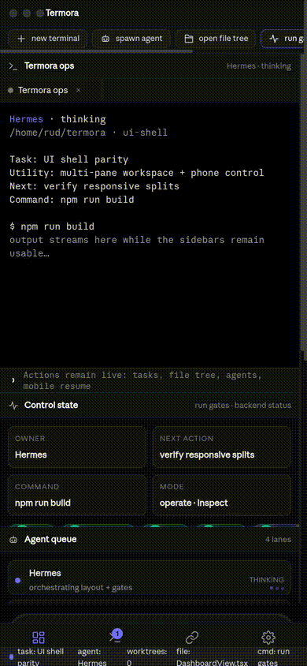

<div align="center">


<br /><br />

[](https://github.com/royaluniondesign-sys/termora/actions/workflows/ci.yml)
[](https://typescriptlang.org)
[](https://nodejs.org)
[](#quickstart)
[](#terminal-cockpit)
[](LICENSE)

<br />

<sub>
  <b>Local-first</b> · <b>Real PTYs</b> · <b>QR pairing</b> · <b>WebSocket streaming</b> · <b>tmux persistence</b> · <b>Agent cockpit roadmap</b>
</sub>

<br /><br />

**Real terminal and agent control from any phone, tablet, or browser.**

A local-first, installable cockpit for Mac/Linux machines: real PTYs, multi-session terminal control, secure QR onboarding, tunnel status, persistent sessions, and a roadmap toward full SSH/SFTP, multi-machine, Git, worktree, and agent orchestration.

[Quickstart](#quickstart) · [Features](#features) · [How it works](#how-it-works) · [Multi-machine](#multi-machine) · [Roadmap](ROADMAP.md) · [Contributing](CONTRIBUTING.md)

</div>

---

<div align="center">



<table>
<tr>
<td align="center"><br /><sub><b>Desktop cockpit</b></sub></td>
<td align="center"><br /><sub><b>Mobile companion</b></sub></td>
</tr>
</table>

[MP4 demo](docs/images/cockpit-tour-v2.mp4)

</div>

---

## Why Termora

Termora is built for developers who run serious work on real machines but want control from anywhere.

Compared with classic mobile SSH clients, Termora gives you a full browser/PWA interface, multi-session previews, custom terminal keyboards, QR pairing, session persistence, and a shareable authenticated URL.

Compared with cloud IDEs, Termora keeps the work on your own Mac/Linux/server. No hosted workspace lock-in, no fake shell, no remote filesystem copy. It streams your real PTY and local agent processes.

Compared with single-agent dashboards, Termora is designed to become the machine cockpit: terminals first today, then files, SSH/SFTP, Git, agents, worktrees, browser previews, notifications, and verification gates in one installable app.

## What works now

- **Real PTY streaming** — zsh/bash/tmux/vim/htop/Claude Code/OpenCode work as real terminal sessions.
- **PWA mobile UI** — install to home screen, fullscreen, custom terminal keyboard, touch action bar, session grid.
- **Secure onboarding** — QR/bootstrap token, JWT session auth, rate-limited auth endpoints.
- **Multi-session control** — create, rename, close, reconnect, preview, and resume terminal sessions.
- **Session persistence** — tmux control mode when available, with fallback to raw PTY.
- **Machine/tunnel status UI** — live dashboard, tunnel cards, QR pairing, and copyable access URL.
- **Connectivity fallback** — LAN/Wi-Fi today, with ngrok/SSH tunnel plumbing in the agent.

## Where it is going

Termora is evolving into an installable, multi-device developer cockpit. The target is not just a terminal skin: it is a real utility layer for agents, worktrees, files, Git, mobile control, previews, notifications, and verification.

| Capability | Status | Termora target |
| --- | --- | --- |
| Mobile companion | **Beta/live PWA** | Monitor sessions from phone, resume work, steer agents, and receive finish/needs-input notifications. Native wrappers/APK/App Store builds are roadmap. |
| Parallel worktrees | **Backend foundation** | Fan one prompt across isolated git worktrees, compare outputs, and merge the winner. Worktree tests/fan-out exist; full UI is in progress. |
| Terminal splits | **Roadmap UI** | Desktop-grade split panes, persistent scrollback, and restart-safe terminal layouts. Current app has real PTYs and tmux persistence. |
| Design mode | **Roadmap** | Inspect a live Chromium surface, capture HTML/CSS/screenshot context, and send it into an agent prompt. |
| GitHub/project task workflows | **Roadmap** | Browse PRs/issues/project boards, open worktrees from tasks, and review without context switching. |
| SSH worktrees | **Roadmap** | Run agents on a beefy remote box with file editing, git, terminals, reconnect, and port forwarding. |
| Annotate AI diffs | **Roadmap** | Comment on generated diff lines and send review notes back to the agent before commit. |
| Drag files/images to agents | **Roadmap** | Attach repo files, screenshots, and images directly to agent prompts. |
| Termora CLI | **Roadmap** | Script workflows such as `termora worktree create`, `termora snapshot`, `termora click`, and `termora fill`. |
| Quick open | **Roadmap** | Search across worktrees, files, agents, commands, and repo context. |
| Usage tracking | **Roadmap** | Track Claude/Codex/OpenCode/Hermes usage, rate-limit resets, and account/provider switching. |
| Rich repo previews | **Roadmap** | Preview Markdown, images, PDFs, docs, browser panes, and logs in the workspace. |
| Computer use | **Roadmap** | Let agents operate visible desktop/browser UI when a workflow needs real interaction. |
| Notifications/unread state | **Roadmap** | Know when an agent finishes or needs attention; mark threads/tasks unread for later. |

See:

- [Product evolution plan](docs/product-evolution.md)
- [Roadmap](ROADMAP.md)
- [Protocol](docs/protocol.md)
- [Security](docs/security.md)
- [Multi-machine](docs/multi-machine.md)

---

## Quickstart

> Requires Node.js 20+ and macOS or Linux.

```bash
git clone https://github.com/royaluniondesign-sys/termora.git
cd termora
npm install
npm run dev
```

Scan the QR code printed in the terminal. Termora opens a real terminal session from your phone or browser.

Already installed:

```bash
cd termora
npm run dev
```

Stop it with `Ctrl+C` in the terminal where `npm run dev` is running.

---

## How it works

Termora is a local agent plus a mobile/browser cockpit. Your phone never talks to a fake shell: it streams authenticated input/output to real PTYs running on your machine.

<div align="center">

<table>
<tr>
<td align="center" width="28%">
  <h3>Client</h3>
  <p><code>Phone</code> · <code>Tablet</code> · <code>Browser</code> · <code>PWA</code></p>
  <sub>Installable mobile UI, QR pairing, terminal controls, cockpit panels.</sub>
</td>
<td align="center" width="8%">
  <h3>↕</h3>
  <p><code>HTTPS</code></p>
  <p><code>WebSocket</code></p>
</td>
<td align="center" width="30%">
  <h3>Tunnel selection</h3>
  <p><code>1</code> ngrok static URL<br /><code>2</code> localhost.run SSH<br /><code>3</code> LAN / Wi‑Fi fallback</p>
  <sub>Best route wins; local network remains available for private use.</sub>
</td>
<td align="center" width="8%">
  <h3>↕</h3>
  <p><code>JWT</code></p>
  <p><code>events</code></p>
</td>
<td align="center" width="30%">
  <h3>termora agent</h3>
  <p><code>real PTYs</code> · <code>tmux control</code><br /><code>SSH/SFTP routes</code> · <code>auth</code><br /><code>up to 8 live sessions</code></p>
  <sub>Your machine stays the runtime: shells, repos, agents, and files remain local.</sub>
</td>
</tr>
</table>

</div>

### Runtime path

| Step | Layer | What happens |
| --- | --- | --- |
| `01` | Start | `npm run dev` launches the backend agent and React cockpit. |
| `02` | Pair | The agent prints a QR/bootstrap URL; the client exchanges it for a session JWT. |
| `03` | Connect | The client uses HTTPS + WebSocket through ngrok, localhost.run, or LAN/Wi‑Fi. |
| `04` | Execute | `node-pty` spawns real shells; tmux keeps sessions alive when available. |
| `05` | Stream | xterm.js renders full ANSI output with fast terminal input, keyboard helpers, and backpressure. |
| `06` | Control | The cockpit can create, rename, close, reconnect, preview, and resume sessions. |

### Core guarantees

<p>
  
  
  
  
  
</p>

---

## Features

### Product capability map

Termora tracks the full agent-cockpit surface explicitly so public docs do not pretend unfinished features are done.

| Feature | Current implementation | Next backend/UI work |
| --- | --- | --- |
| **Mobile Companion** | Installable PWA, QR pairing, JWT auth, terminal/session cockpit. | Push notifications, unread state, native wrappers/APK/App Store packaging. |
| **Parallel Worktrees** | Backend worktree utilities and tests; fan-out foundation exists. | UI for prompt fan-out, compare results, choose winner, archive losers. |
| **Terminal Splits** | Real PTY sessions, tmux persistence, dashboard split cockpit. | True user-created split panes, saved layouts, split resize, long scrollback search. |
| **Design Mode** | Browser/capture tooling exists for QA/media generation. | In-app Chromium inspector: click element → HTML/CSS/cropped screenshot → agent context. |
| **GitHub & task workflows** | GitHub CI integration and local gh-based verification process. | In-app PR/issues/project boards, task-to-worktree launch, review UI. |
| **SSH Worktrees** | Remote Linux server workflow verified manually via Tailscale SSH. | First-class remote host registry, SSH worktree spawn, reconnect and port-forward UI. |
| **Annotate AI Diffs** | Git status endpoints and planned diff surface. | Inline diff comments shipped back to the active agent. |
| **Drag Files to Agents** | File tree backend foundation. | Drag/drop files/images into prompts and persist attachments per run. |
| **Termora CLI** | npm/dev scripts today. | `termora worktree create`, `snapshot`, `click`, `fill`, `agent run`, `gates watch`. |
| **Quick Open** | Command strip prototype wired to backend actions. | Global search across commands/files/sessions/agents/worktrees. |
| **Usage Tracking** | Provider/model constraints documented for operations. | In-app usage/rate-limit reset display and account switcher. |
| **Rich Repo Previews** | README media and image previews in docs. | Markdown/image/PDF/doc previews inside the cockpit. |
| **Computer Use** | Hermes/browser automation used during development. | Expose safe visible-UI control as a Termora workflow. |
| **Notifications** | Session status visible in app. | Done/failed/needs-input push notifications and unread markers. |

### Supported agent model

Termora is designed around a simple rule: if an agent runs as a CLI in a terminal, Termora should be able to host, supervise, and resume it.

Current/target agent families include: Claude Code, Codex, Grok, Cursor/Copilot-style CLIs, DeepSeek/Qwen/Kimi/Mistral code CLIs, OpenCode, Hermes Agent, Goose, Cline, Continue, Aider-style tools, and any custom CLI agent configured by command template.

### Terminal cockpit

- Multiple live PTY sessions.
- Session grid with previews.
- Rename, close, reconnect, and scrollback replay.
- Context strip for Esc, function keys, commit, diff, plan, Ctrl+C.
- Touch action bar for select/copy/paste/cut/tab/history.
- iOS-style and MacBook-style terminal keyboards.
- Sticky Shift/Ctrl/Opt/Cmd modifiers.
- Hardware-accelerated terminal rendering.

### Machine access

- Authenticated connection panel.
- Copyable one-click auth URL.
- QR onboarding.
- ngrok/SSH/LAN tunnel modes.
- Static URL support per machine.

### Security

| Layer | Protection |
| --- | --- |
| Pairing | Short-lived bootstrap token |
| Session auth | JWT rotation |
| Static access | Persistent token stored locally |
| Transport | HTTPS tunnel or local network |
| Auth routes | Rate limited |
| Terminal input | Size bounds and validation |
| Output flow | WebSocket backpressure |
| Secrets | Sensitive env stripped from PTY env |
| Storage | No hosted workspace or cloud file copy |

### Developer workflow

- TypeScript monorepo with npm workspaces.
- Turborepo tasks for lint/typecheck/test/build.
- CI workflow on Node 20, 22, and 24.
- Shared protocol package for client/server message contracts.
- Vitest coverage for auth, protocol lifecycle, session persistence, worktree fan-out, and device revocation.

---

## Multi-machine

Run Termora on every machine you want to control.

```bash
git clone https://github.com/royaluniondesign-sys/termora.git
cd termora
npm install
npm run dev
```

Each machine prints its own QR/auth URL. Bookmark each URL or add each as a separate PWA icon.

Optional stable domains:

```bash
# Machine A
NGROK_STATIC_DOMAIN=macbook.ngrok-free.dev npm run dev

# Machine B
NGROK_STATIC_DOMAIN=server.ngrok-free.dev npm run dev
```

---

## Configuration

Create `.env` in the project root. All fields are optional.

```bash
NGROK_AUTHTOKEN=your_token
NGROK_STATIC_DOMAIN=your.ngrok-free.dev
TERMORA_PORT=4030
TERMORA_MAX_SESSIONS=8
TERMORA_NO_TMUX=1
TUNNEL=ssh
```

`TERMORA_PORT` takes precedence over `PORT`.

---

## Commands

```bash
npm run dev         # start agent + web client
npm run lint        # eslint all packages
npm run typecheck   # TypeScript checks
npm test            # Vitest suites
npm run build       # production build
```

---

## Tech stack

| Layer | Technology |
| --- | --- |
| Web | React 18, TypeScript, Vite 6, Tailwind CSS v4, xterm.js |
| Agent | Node.js 20+, Express, ws, node-pty, better-sqlite3 |
| Sessions | PTY + tmux control mode |
| Tunnels | ngrok SDK, localhost.run SSH fallback, LAN fallback |
| Auth | jose JWT, bootstrap/static tokens, express-rate-limit |
| SSH/SFTP | ssh2, authenticated API routes |
| Monorepo | npm workspaces, Turborepo |
| Tests | Vitest |

---

## Project layout

```text
packages/agent   Local machine agent, auth, PTY, SSH/SFTP, tunnels
packages/web     Installable PWA/web cockpit
packages/shared  Shared WebSocket protocol types
packages/cli     CLI wrapper and automation entrypoint
docs/            Security, protocol, multi-machine, product evolution
```

---

## Contributing

Read [CONTRIBUTING.md](CONTRIBUTING.md). Keep changes verified with:

```bash
npm run lint
npm run typecheck
npm test
npm run build
```

## License

MIT — see [LICENSE](LICENSE).
