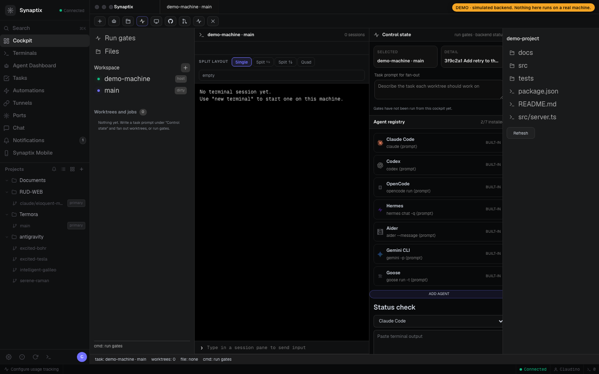
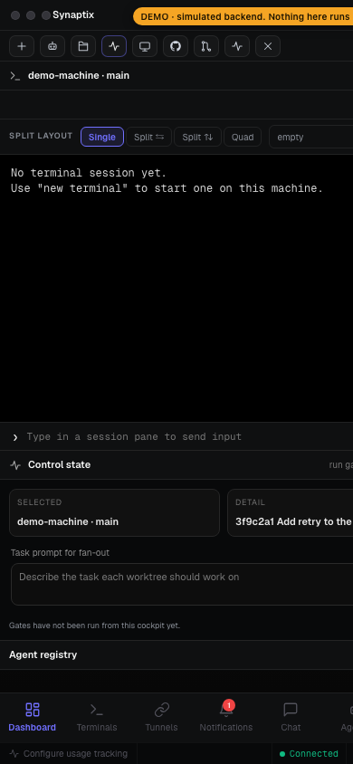

<div align="center">

<!-- Synaptix logo mark -->
<svg xmlns="http://www.w3.org/2000/svg" viewBox="0 0 96 96" width="72" height="72" fill="none">
  <line x1="48" y1="48" x2="20" y2="20" stroke="#7170ff" stroke-width="2.4" stroke-linecap="round" opacity="0.55"/>
  <line x1="48" y1="48" x2="76" y2="20" stroke="#7170ff" stroke-width="2.4" stroke-linecap="round" opacity="0.55"/>
  <line x1="48" y1="48" x2="20" y2="76" stroke="#7170ff" stroke-width="2.4" stroke-linecap="round" opacity="0.55"/>
  <line x1="48" y1="48" x2="76" y2="76" stroke="#7170ff" stroke-width="2.4" stroke-linecap="round" opacity="0.55"/>
  <line x1="48" y1="48" x2="48" y2="10"  stroke="#7170ff" stroke-width="2.4" stroke-linecap="round" opacity="0.35"/>
  <line x1="48" y1="48" x2="48" y2="86"  stroke="#7170ff" stroke-width="2.4" stroke-linecap="round" opacity="0.35"/>
  <line x1="48" y1="48" x2="10" y2="48"  stroke="#7170ff" stroke-width="2.4" stroke-linecap="round" opacity="0.35"/>
  <line x1="48" y1="48" x2="86" y2="48"  stroke="#7170ff" stroke-width="2.4" stroke-linecap="round" opacity="0.35"/>
  <circle cx="20" cy="20" r="6"  fill="#a78bfa" opacity="0.85"/>
  <circle cx="76" cy="20" r="6"  fill="#7170ff" opacity="0.85"/>
  <circle cx="20" cy="76" r="6"  fill="#7170ff" opacity="0.85"/>
  <circle cx="76" cy="76" r="6"  fill="#a78bfa" opacity="0.85"/>
  <circle cx="48" cy="10" r="3.5" fill="#6366f1" opacity="0.6"/>
  <circle cx="48" cy="86" r="3.5" fill="#6366f1" opacity="0.6"/>
  <circle cx="10" cy="48" r="3.5" fill="#6366f1" opacity="0.6"/>
  <circle cx="86" cy="48" r="3.5" fill="#6366f1" opacity="0.6"/>
  <circle cx="48" cy="48" r="15" fill="url(#rg)"/>
  <circle cx="48" cy="48" r="10" fill="#7170ff"/>
  <circle cx="48" cy="48" r="5"  fill="#c4b5fd"/>
  <defs>
    <radialGradient id="rg" cx="50%" cy="50%" r="50%">
      <stop offset="0%"   stop-color="#7170ff" stop-opacity="0.4"/>
      <stop offset="100%" stop-color="#7170ff" stop-opacity="0"/>
    </radialGradient>
  </defs>
</svg>

# Synaptix

**AI agent orchestration. Real terminals. Your machine.**

<br />

[](https://github.com/royaluniondesign-sys/synaptix/actions/workflows/ci.yml)
[](https://typescriptlang.org)
[](https://nodejs.org)
[](#quickstart)
[](#terminal-cockpit)
[](LICENSE)

<br />

<sub>
  <b>Local-first</b> · <b>Real PTYs</b> · <b>QR pairing</b> · <b>WebSocket streaming</b> · <b>tmux persistence</b> · <b>Agent cockpit roadmap</b>
</sub>

<br /><br />

**Real terminal and agent control from any phone, tablet, or browser.**

A local-first, installable cockpit for Mac/Linux machines: real PTYs, multi-session terminal control, secure QR onboarding, tunnel status, persistent sessions, and a roadmap toward full SSH/SFTP, multi-machine, Git, worktree, and agent orchestration.

[**Website & live demo**](https://royaluniondesign-sys.github.io/synaptix/) · [Quickstart](#quickstart) · [Features](#features) · [How it works](#how-it-works) · [Multi-machine](#multi-machine) · [Roadmap](ROADMAP.md) · [Contributing](CONTRIBUTING.md)

</div>

---

<div align="center">

<table>
<tr>
<td align="center"><br /><sub><b>Desktop cockpit</b></sub></td>
<td align="center"><br /><sub><b>Mobile companion</b></sub></td>
</tr>
</table>

</div>

---

## Why Synaptix

Synaptix is built for developers who run serious work on real machines but want control from anywhere.

Compared with classic mobile SSH clients, Synaptix gives you a full browser/PWA interface, multi-session previews, custom terminal keyboards, QR pairing, session persistence, and a shareable authenticated URL.

Compared with cloud IDEs, Synaptix keeps the work on your own Mac/Linux/server. No hosted workspace lock-in, no fake shell, no remote filesystem copy. It streams your real PTY and local agent processes.

Compared with single-agent dashboards, Synaptix is designed to become the machine cockpit: terminals first today, then files, SSH/SFTP, Git, agents, worktrees, browser previews, notifications, and verification gates in one installable app.

## What works now

Synaptix now has a verified local-first cockpit foundation. The current repo state is intentionally split between **implemented**, **guarded**, and **roadmap** so the project page does not pretend platform work is finished before artifacts exist.

### Implemented and verified

- **Real PTY streaming** — zsh/bash/tmux/vim/htop/Claude Code/OpenCode work as real terminal sessions.
- **PWA mobile/browser UI** — install to home screen, fullscreen, custom terminal keyboard, touch action bar, session grid, and responsive cockpit navigation.
- **Secure onboarding** — QR/bootstrap token exchange, JWT session auth, rate-limited auth endpoints, and token-redacted dogfood checks.
- **Multi-session control** — create, rename, close, reconnect, preview, and resume terminal sessions.
- **Session persistence** — tmux control mode when available, with fallback to raw PTY.
- **Agent cockpit backend** — protected cockpit status, file listing, safe file preview, whitelisted actions, job status, fan-out/list/delete worktree routes, read-only GitHub status, events, and unread notification model.
- **Cockpit UI slices** — file inspector, GitHub workflow status, notifications/unread panel, controlled split layout, and multi-pane terminal rendering foundations.
- **CLI MVP** — `synaptix help`, `version`, `status`, and `file <path>` with local fallback or authenticated remote API mode.
- **Desktop app boundary** — Electron main/preload/launcher contracts, dynamic Electron loader, desktop lifecycle tests, desktop smoke and launch-smoke contracts.
- **Dogfood and release gates** — `check:cockpit`, `check:web-headless`, `check:desktop-boundary`, `check:desktop-smoke`, `check:desktop-launch`, `check:desktop-artifact-preflight`, `check:platform-readiness`, and `check:security-audit` run locally/CI.
- **Security hygiene** — production audit gate is clean; desktop out-of-workspace audit is separately checked before release work.

### Guarded, not yet released

- **Unsigned desktop packaging** — dry-run helper and electron-builder config exist, but no `.dmg`, `.zip`, NSIS, AppImage, or `.deb` artifact is published yet.
- **Electron GUI launch** — contracts and smoke checks exist; real host GUI launch and installed-app smoke remain pending.
- **Native mobile** — Expo scaffold exists; secure storage, pairing flow, push, APK/TestFlight/App Store builds remain pending.
- **Store/release readiness** — docs and checkers enforce honest claims, but signing, notarization, SBOM/provenance, release uploads, checksums, and store metadata remain pending.

## Where it is going

Synaptix is evolving into an installable, multi-device developer cockpit. The target is not just a terminal skin: it is a real utility layer for agents, worktrees, files, Git, mobile control, previews, notifications, and verification.

| Capability | Status | Synaptix target |
| --- | --- | --- |
| Mobile companion | **Live PWA / native scaffold** | Monitor sessions from phone, resume work, steer agents, and receive finish/needs-input notifications. Native wrappers/APK/App Store builds are roadmap. |
| Parallel worktrees | **Backend foundation + UI actions** | Fan one prompt across isolated git worktrees, compare outputs, and merge the winner. Worktree tests/fan-out exist; full compare/winner UI is in progress. |
| Terminal splits | **Partial UI + model** | Desktop-grade split panes, persistent scrollback, and restart-safe layouts. Current app has real PTYs, tmux persistence, and controlled multi-pane rendering. |
| Design mode | **Roadmap** | Inspect a live Chromium surface, capture HTML/CSS/screenshot context, and send it into an agent prompt. |
| GitHub/project workflows | **Read-only live status** | Browse PRs/issues/project boards, open worktrees from tasks, and review without context switching. Current slice reports local `gh` auth/repo/branch/PR hints. |
| SSH worktrees | **Ops-proven, product pending** | Run agents on a remote box with file editing, git, terminals, reconnect, and port forwarding. Product host registry/UI is pending. |
| Annotate AI diffs | **Roadmap** | Comment on generated diff lines and send review notes back to the agent before commit. |
| Drag files/images to agents | **Roadmap** | Attach repo files, screenshots, and images directly to agent prompts. |
| Synaptix CLI | **MVP** | Current commands cover help/version/status/file. Worktree/snapshot/click/fill/agent/gates commands remain roadmap. |
| Quick open | **Roadmap** | Search across worktrees, files, agents, commands, and repo context. |
| Usage tracking | **Roadmap** | Track Claude/Codex/OpenCode/Hermes usage, rate-limit resets, and account/provider switching. |
| Rich repo previews | **File preview foundation** | Preview Markdown, images, PDFs, docs, browser panes, and logs in the workspace. |
| Computer use | **Roadmap** | Let agents operate visible desktop/browser UI when a workflow needs real interaction. |
| Notifications/unread state | **Backend + UI partial** | Know when an agent finishes or needs attention; mark threads/tasks unread for later. |

See:

- [Product evolution plan](docs/product-evolution.md)
- [Roadmap](ROADMAP.md)
- [Agent cockpit capabilities](docs/agent-cockpit-capabilities.md)
- [Feature/platform map](docs/feature-platform-map.md)
- [Platform readiness checklist](docs/platform-readiness-checklist.md)
- [Desktop unsigned packaging contract](docs/desktop-unsigned-packaging.md)

---

## Quickstart

> Requires Node.js 20+ and macOS or Linux.

```bash
git clone https://github.com/royaluniondesign-sys/synaptix.git
cd synaptix
npm install
npm run dev
```

Scan the QR code printed in the terminal. Synaptix opens a real terminal session from your phone or browser.

Already installed:

```bash
cd synaptix
npm run dev
```

Stop it with `Ctrl+C` in the terminal where `npm run dev` is running.

---

## How it works

Synaptix is a local agent plus a mobile/browser cockpit. Your phone never talks to a fake shell: it streams authenticated input/output to real PTYs running on your machine.

<div align="center">

<table>
<tr>
<td align="center" width="28%">
  <h3>Client</h3>
  <p><code>Phone</code> · <code>Tablet</code> · <code>Browser</code> · <code>PWA</code></p>
  <sub>Installable mobile UI, QR pairing, terminal controls, cockpit panels.</sub>
</td>
<td align="center" width="8%">
  <h3>↕</h3>
  <p><code>HTTPS</code></p>
  <p><code>WebSocket</code></p>
</td>
<td align="center" width="30%">
  <h3>Tunnel selection</h3>
  <p><code>1</code> ngrok static URL<br /><code>2</code> localhost.run SSH<br /><code>3</code> LAN / Wi‑Fi fallback</p>
  <sub>Best route wins; local network remains available for private use.</sub>
</td>
<td align="center" width="8%">
  <h3>↕</h3>
  <p><code>JWT</code></p>
  <p><code>events</code></p>
</td>
<td align="center" width="30%">
  <h3>synaptix agent</h3>
  <p><code>real PTYs</code> · <code>tmux control</code><br /><code>SSH/SFTP routes</code> · <code>auth</code><br /><code>up to 8 live sessions</code></p>
  <sub>Your machine stays the runtime: shells, repos, agents, and files remain local.</sub>
</td>
</tr>
</table>

</div>

### Runtime path

| Step | Layer | What happens |
| --- | --- | --- |
| `01` | Start | `npm run dev` launches the backend agent and React cockpit. |
| `02` | Pair | The agent prints a QR/bootstrap URL; the client exchanges it for a session JWT. |
| `03` | Connect | The client uses HTTPS + WebSocket through ngrok, localhost.run, or LAN/Wi‑Fi. |
| `04` | Execute | `node-pty` spawns real shells; tmux keeps sessions alive when available. |
| `05` | Stream | xterm.js renders full ANSI output with fast terminal input, keyboard helpers, and backpressure. |
| `06` | Control | The cockpit can create, rename, close, reconnect, preview, and resume sessions. |

### Core guarantees

<p>
  
  
  
  
  
</p>

---

## Features

### Product capability map

Synaptix tracks the full agent-cockpit surface explicitly so public docs do not pretend unfinished features are done.

| Feature | Current implementation | Next backend/UI work |
| --- | --- | --- |
| **Mobile Companion** | Installable PWA, QR pairing, JWT auth, terminal/session cockpit, native scaffold. | Native secure storage, QR/deep-link pairing, push, APK/TestFlight/App Store packaging. |
| **Parallel Worktrees** | Backend worktree utilities, fan-out/list/delete routes, tests, and cockpit actions. | Compare diffs, choose winner, archive losers, and show run lanes. |
| **Terminal Splits** | Real PTY sessions, tmux persistence, controlled split layout, multi-pane terminal rendering. | User-created resizeable layouts, saved presets, scrollback search. |
| **Design Mode** | Browser/capture tooling used during development. | In-app Chromium inspector: click element → HTML/CSS/cropped screenshot → agent context. |
| **GitHub workflows** | Read-only `gh` status endpoint/action plus compact dashboard status. | PR/issues/project UI, task-to-worktree launch, review/merge flow. |
| **SSH Worktrees** | Remote Linux orchestration proven operationally over Tailscale SSH. | Product host registry, SSH worktree spawn, reconnect, file editing, port-forward UI. |
| **Annotate AI Diffs** | Git status/diff direction documented. | Inline diff comments shipped back to the active agent. |
| **Drag Files to Agents** | Safe file listing and preview backend. | Drag/drop files/images into prompts and persist attachments per run. |
| **Synaptix CLI** | `help`, `version`, `status`, `file` with local and authenticated remote modes. | Worktree, snapshot, browser action, agent run, and gate-watch commands. |
| **Quick Open** | Roadmap. | Global search across commands/files/sessions/agents/worktrees. |
| **Usage Tracking** | Provider/model constraints documented for operations. | In-app usage/rate-limit reset display and account switcher. |
| **Rich Repo Previews** | Safe text/image file preview foundation. | Markdown/image/PDF/doc previews inside the cockpit. |
| **Computer Use** | Hermes/browser automation used during development. | Safe visible-UI control as a Synaptix workflow. |
| **Notifications** | Event bus, SSE stream, unread model, notifications tab. | Push notifications and richer task/session unread markers. |

### Supported agent model

Synaptix is designed around a simple rule: if an agent runs as a CLI in a terminal, Synaptix should be able to host, supervise, and resume it.

Current/target agent families include: Claude Code, Codex, Grok, Cursor/Copilot-style CLIs, DeepSeek/Qwen/Kimi/Mistral code CLIs, OpenCode, Hermes Agent, Goose, Cline, Continue, Aider-style tools, and any custom CLI agent configured by command template.

### Terminal cockpit

- Multiple live PTY sessions.
- Session grid with previews.
- Rename, close, reconnect, and scrollback replay.
- Context strip for Esc, function keys, commit, diff, plan, Ctrl+C.
- Touch action bar for select/copy/paste/cut/tab/history.
- iOS-style and MacBook-style terminal keyboards.
- Sticky Shift/Ctrl/Opt/Cmd modifiers.
- Hardware-accelerated terminal rendering.

### Machine access

- Authenticated connection panel.
- Copyable one-click auth URL.
- QR onboarding.
- ngrok/SSH/LAN tunnel modes.
- Static URL support per machine.

### Security

| Layer | Protection |
| --- | --- |
| Pairing | Short-lived bootstrap token |
| Session auth | JWT rotation |
| Static access | Persistent token stored locally |
| Transport | HTTPS tunnel or local network |
| Auth routes | Rate limited |
| Terminal input | Size bounds and validation |
| Output flow | WebSocket backpressure |
| Secrets | Sensitive env stripped from PTY env |
| Storage | No hosted workspace or cloud file copy |

### Developer workflow

- TypeScript monorepo with npm workspaces.
- Turborepo tasks for lint/typecheck/test/build.
- CI workflow on Node 20, 22, and 24.
- Shared protocol package for client/server message contracts.
- Vitest coverage for auth, protocol lifecycle, session persistence, worktree fan-out, and device revocation.

---

## Multi-machine

Run Synaptix on every machine you want to control.

```bash
git clone https://github.com/royaluniondesign-sys/synaptix.git
cd synaptix
npm install
npm run dev
```

Each machine prints its own QR/auth URL. Bookmark each URL or add each as a separate PWA icon.

Optional stable domains:

```bash
# Machine A
NGROK_STATIC_DOMAIN=macbook.ngrok-free.dev npm run dev

# Machine B
NGROK_STATIC_DOMAIN=server.ngrok-free.dev npm run dev
```

---

## Configuration

Create `.env` in the project root. All fields are optional.

```bash
NGROK_AUTHTOKEN=your_token
NGROK_STATIC_DOMAIN=your.ngrok-free.dev
SYNAPTIX_PORT=4030
SYNAPTIX_MAX_SESSIONS=8
SYNAPTIX_NO_TMUX=1
TUNNEL=ssh
```

`SYNAPTIX_PORT` takes precedence over `PORT`.

---

## Commands

```bash
npm run dev         # start agent + web client
npm run lint        # eslint all packages
npm run typecheck   # TypeScript checks
npm test            # Vitest suites
npm run build       # production build
npm run check:cockpit  # exercise a live agent's cockpit API (skips without env)
```

`npm run check:cockpit` is the dogfood check for a live agent. With
`SYNAPTIX_URL` (e.g. `http://127.0.0.1:4030`) and `SYNAPTIX_TOKEN` set it
exercises the health, status, files, README preview, github and events
endpoints; without them it prints a skip notice and exits 0. It never prints
tokens — keep them in your env, not your logs.

---

## Tech stack

| Layer | Technology |
| --- | --- |
| Web | React 18, TypeScript, Vite 6, Tailwind CSS v4, xterm.js |
| Agent | Node.js 20+, Express, ws, node-pty, better-sqlite3 |
| Sessions | PTY + tmux control mode |
| Tunnels | ngrok SDK, localhost.run SSH fallback, LAN fallback |
| Auth | jose JWT, bootstrap/static tokens, express-rate-limit |
| SSH/SFTP | ssh2, authenticated API routes |
| Monorepo | npm workspaces, Turborepo |
| Tests | Vitest |

---

## Project layout

```text
packages/agent   Local machine agent, auth, PTY, SSH/SFTP, tunnels
packages/web     Installable PWA/web cockpit
packages/cli     Local/remote CLI MVP
packages/cli     CLI wrapper and automation entrypoint
docs/            Security, protocol, multi-machine, product evolution
```

---

## Contributing

Read [CONTRIBUTING.md](CONTRIBUTING.md). Keep changes verified with:

```bash
npm run lint
npm run typecheck
npm test
npm run build
```

## License

MIT — see [LICENSE](LICENSE).
