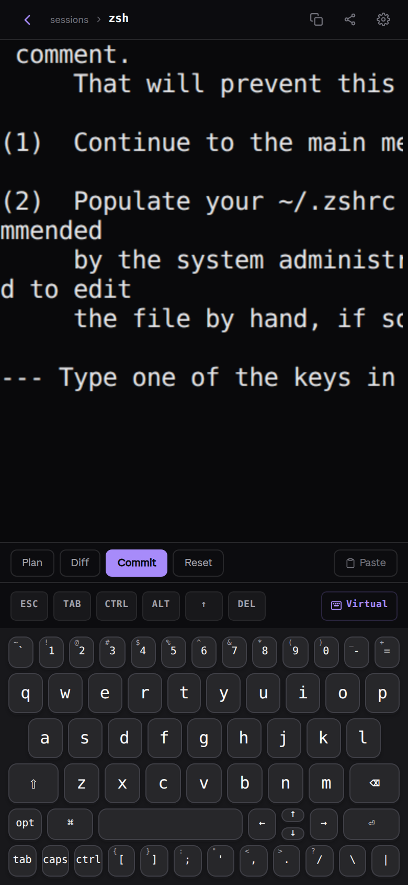
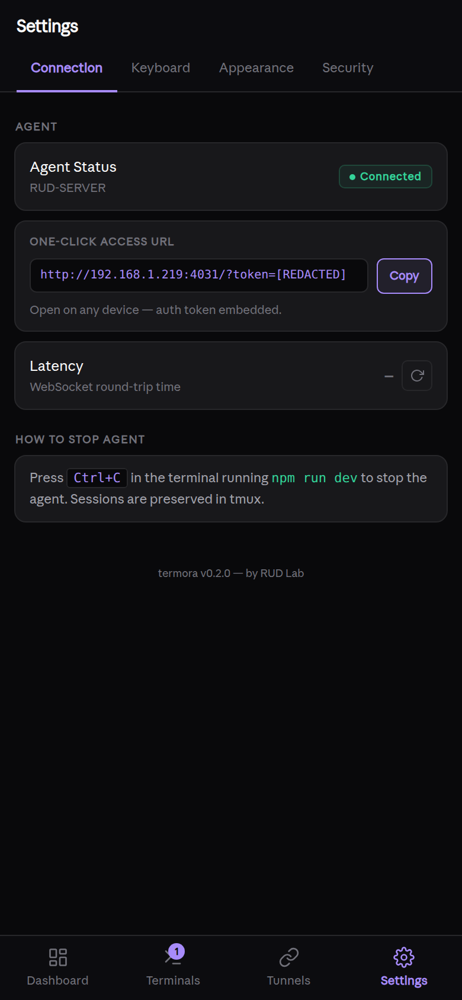

<div align="center">


<br /><br />

[](https://github.com/royaluniondesign-sys/termora/actions/workflows/ci.yml)
[](https://typescriptlang.org)
[](https://nodejs.org)
[](LICENSE)
[]()

**Real terminal and agent control from any phone, tablet, or browser.**

A local-first, installable cockpit for Mac/Linux machines: real PTYs, SSH/SFTP, multi-session terminal control, multi-machine access, secure QR onboarding, persistent sessions, and a roadmap toward full agent/worktree orchestration.

[Quickstart](#quickstart) · [Features](#features) · [How it works](#how-it-works) · [Multi-machine](#multi-machine) · [Roadmap](ROADMAP.md) · [Contributing](CONTRIBUTING.md)

</div>

---

<div align="center">
<table>
<tr>
<td align="center"><br /><sub><b>Real Terminal</b></sub></td>
<td align="center"><br /><sub><b>Quick Commands</b></sub></td>
<td align="center"><br /><sub><b>Session Grid</b></sub></td>
</tr>
<tr>
<td align="center"><br /><sub><b>Connection Status</b></sub></td>
<td align="center"><br /><sub><b>Machine Control</b></sub></td>
<td></td>
</tr>
</table>
</div>

---

## Why Termora

Termora is built for developers who run serious work on real machines but want control from anywhere.

Compared with classic mobile SSH clients, Termora gives you a full browser/PWA interface, multi-session previews, custom terminal keyboards, QR pairing, session persistence, and a shareable authenticated URL.

Compared with cloud IDEs, Termora keeps the work on your own Mac/Linux/server. No hosted workspace lock-in, no fake shell, no remote filesystem copy. It streams your real PTY and local agent processes.

Compared with single-agent dashboards, Termora is designed to become the machine cockpit: terminals, files, SSH/SFTP, Git, agents, worktrees, browser previews, notifications, and verification gates in one installable app.

## What works now

- **Real PTY streaming** — zsh/bash/tmux/vim/htop/Claude Code/OpenCode work as real terminal sessions.
- **PWA mobile UI** — install to home screen, fullscreen, custom terminal keyboard, touch action bar, session grid.
- **Secure onboarding** — QR/bootstrap token, JWT session auth, rate-limited auth endpoints.
- **Multi-session control** — create, rename, close, reconnect, preview, and resume terminal sessions.
- **Session persistence** — tmux control mode when available, with fallback to raw PTY.
- **Multi-machine usage** — run one agent per machine/server, bookmark each URL, or use static ngrok domains.
- **Connectivity fallback** — ngrok static URL, localhost.run SSH tunnel, or LAN/Wi-Fi fallback.
- **SSH host manager** — save SSH targets, connect from the UI, verify host keys.
- **SFTP file transfer** — browse, upload, and download files through authenticated routes.
- **Shared protocol package** — typed WebSocket protocol shared by agent and web client.
- **CLI wrapper** — project prepared for `termora` command packaging.
- **CI-ready monorepo** — lint, typecheck, test, and build via Turborepo.

## Where it is going

Termora is evolving into an installable, multi-device developer cockpit:

- project/workspace registry;
- isolated git worktrees per task;
- launch and monitor CLI agents from mobile;
- diff/source-control review from phone;
- browser previews per worktree;
- push notifications when work finishes or needs input;
- run records with lint/typecheck/test/build gates;
- MCP/webhook integrations for external automation;
- desktop-grade panes: file tree, editor, terminal splits, logs, previews, command palette.

See:

- [Product evolution plan](docs/product-evolution.md)
- [Roadmap](ROADMAP.md)
- [Protocol](docs/protocol.md)
- [Security](docs/security.md)
- [Multi-machine](docs/multi-machine.md)

---

## Quickstart

> Requires Node.js 20+ and macOS or Linux.

```bash
git clone https://github.com/royaluniondesign-sys/termora.git
cd termora
npm install
npm run dev
```

Scan the QR code printed in the terminal. Termora opens a real terminal session from your phone or browser.

Already installed:

```bash
cd termora
npm run dev
```

Stop it with `Ctrl+C` in the terminal where `npm run dev` is running.

---

## How it works

```text
  Phone / Tablet / Browser
        |
        | HTTPS + WebSocket
        v
  +---------------------------+
  |  Tunnel auto-selection    |
  |  1. ngrok static URL      |
  |  2. localhost.run SSH     |
  |  3. LAN / Wi-Fi fallback  |
  +------------+--------------+
               v
  +---------------------------+
  | termora agent             |
  | real PTYs + tmux control  |
  | SSH/SFTP + auth + routes  |
  | up to 8 live sessions     |
  +---------------------------+
```

1. `npm run dev` starts the backend agent and React frontend.
2. The agent spawns real terminal sessions through `node-pty`.
3. A tunnel exposes the agent over HTTPS or LAN.
4. A short-lived bootstrap token pairs your browser/phone.
5. xterm.js renders full ANSI terminal output with WebGL acceleration.
6. tmux keeps sessions alive across reconnects and restarts when installed.

---

## Features

### Terminal cockpit

- Multiple live PTY sessions.
- Session grid with previews.
- Rename, close, reconnect, and scrollback replay.
- Context strip for Esc, function keys, commit, diff, plan, Ctrl+C.
- Touch action bar for select/copy/paste/cut/tab/history.
- iOS-style and MacBook-style terminal keyboards.
- Sticky Shift/Ctrl/Opt/Cmd modifiers.
- Hardware-accelerated terminal rendering.

### Machine access

- Authenticated connection panel.
- Copyable one-click auth URL.
- QR onboarding.
- ngrok/SSH/LAN tunnel modes.
- Static URL support per machine.
- Multi-machine workflow through separate installable PWAs/bookmarks.

### SSH and files

- SSH host CRUD routes.
- Host-key verification helpers.
- SSH session creation from web UI.
- SFTP browse/upload/download.
- JWT-protected SSH/SFTP APIs.

### Security

| Layer | Protection |
| --- | --- |
| Pairing | Short-lived bootstrap token |
| Session auth | JWT rotation |
| Static access | Persistent token stored locally |
| Transport | HTTPS tunnel or local network |
| Auth routes | Rate limited |
| Terminal input | Size bounds and validation |
| Output flow | WebSocket backpressure |
| Secrets | Sensitive env stripped from PTY env |
| Storage | No hosted workspace or cloud file copy |

### Developer workflow

- TypeScript monorepo with npm workspaces.
- Turborepo tasks for lint/typecheck/test/build.
- CI workflow on Node 20 and 22.
- Shared protocol package for client/server message contracts.
- Vitest coverage for auth, SSH hosts, known_hosts, SSH command safety, SFTP, and protocol lifecycle.

---

## Multi-machine

Run Termora on every machine you want to control.

```bash
git clone https://github.com/royaluniondesign-sys/termora.git
cd termora
npm install
npm run dev
```

Each machine prints its own QR/auth URL. Bookmark each URL or add each as a separate PWA icon.

Optional stable domains:

```bash
# Machine A
NGROK_STATIC_DOMAIN=macbook.ngrok-free.dev npm run dev

# Machine B
NGROK_STATIC_DOMAIN=server.ngrok-free.dev npm run dev
```

---

## Configuration

Create `.env` in the project root. All fields are optional.

```bash
NGROK_AUTHTOKEN=your_token
NGROK_STATIC_DOMAIN=your.ngrok-free.dev
TERMORA_PORT=4030
TERMORA_MAX_SESSIONS=8
TERMORA_NO_TMUX=1
TUNNEL=ssh
```

`TERMORA_PORT` takes precedence over `PORT`.

---

## Commands

```bash
npm run dev         # start agent + web client
npm run lint        # eslint all packages
npm run typecheck   # TypeScript checks
npm test            # Vitest suites
npm run build       # production build
```

---

## Tech stack

| Layer | Technology |
| --- | --- |
| Web | React 18, TypeScript, Vite 6, Tailwind CSS v4, xterm.js |
| Agent | Node.js 20+, Express, ws, node-pty, better-sqlite3 |
| Sessions | PTY + tmux control mode |
| Tunnels | ngrok SDK, localhost.run SSH fallback, LAN fallback |
| Auth | jose JWT, bootstrap/static tokens, express-rate-limit |
| SSH/SFTP | ssh2, authenticated API routes |
| Monorepo | npm workspaces, Turborepo |
| Tests | Vitest |

---

## Project layout

```text
packages/agent   Local machine agent, auth, PTY, SSH/SFTP, tunnels
packages/web     Installable PWA/web cockpit
packages/shared  Shared WebSocket protocol types
packages/cli     CLI wrapper and automation entrypoint
docs/            Security, protocol, multi-machine, product evolution
```

---

## Contributing

Read [CONTRIBUTING.md](CONTRIBUTING.md). Keep changes verified with:

```bash
npm run lint
npm run typecheck
npm test
npm run build
```

## License

MIT — see [LICENSE](LICENSE).
